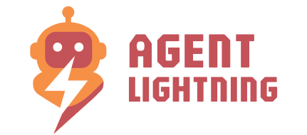
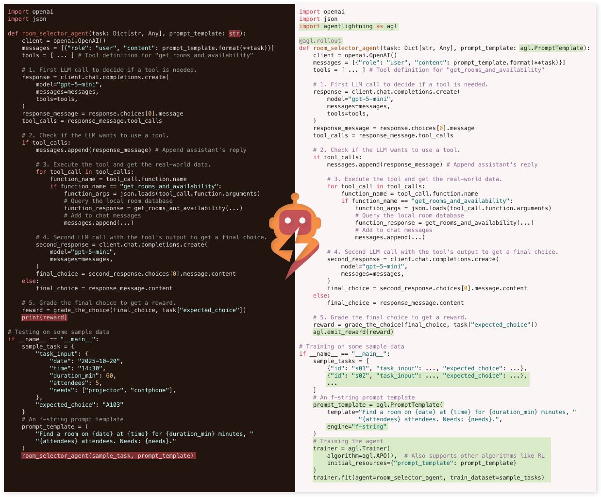
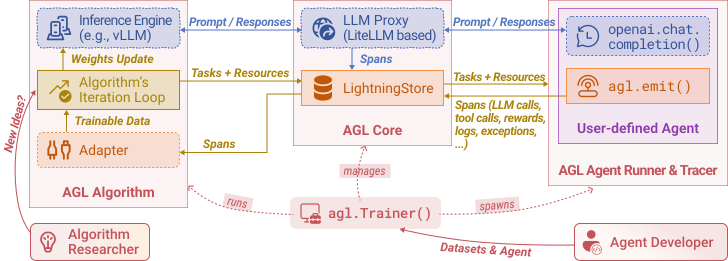

<p align="center">
  
</p>

# Agent Lightning⚡

[](https://github.com/Alexi5000/agent-lightning/actions/workflows/tests.yml)
[](https://microsoft.github.io/agent-lightning/)
[](https://badge.fury.io/py/agentlightning)
[](LICENSE)
[](https://deepwiki.com/microsoft/agent-lightning)
[](https://discord.gg/RYk7CdvDR7)

**The absolute trainer to light up AI agents.**

Join our [Discord community](https://discord.gg/RYk7CdvDR7) to connect with other users and contributors.

## ⚡ Why this fork exists

**What it does.** Agent Lightning lets an agent written with any framework (LangChain, OpenAI Agents SDK, AutoGen, CrewAI, Microsoft Agent Framework, or plain Python) be optimized without rewriting it: a tracer or the `agl.emit_*` helpers turn prompts, tool calls, and rewards into spans in the LightningStore, and an algorithm (reinforcement learning through VERL, automatic prompt optimization, or supervised fine-tuning) reads those spans and posts updated prompts or policy weights back through the Trainer. This fork keeps the 0.3.1-era codebase with hardened, CPU-validated dependency profiles.

**Who it serves.** Engineers who want to evaluate agent training or prompt optimization on a dependency set that resolves and passes tests on CPU-only Python 3.11 to 3.13 before committing GPU time, and operators who need the legacy integrations (LiteLLM proxy, Tinker q20 example, VERL v0 HTTP proxy) kept behind explicit, documented boundaries rather than silently installed.

**Why Alex forked it.** The fork was created on 2025-11-01 (GitHub `created_at`). In May 2026 it staged three upstream pull requests to microsoft/agent-lightning that remain open: [#528](https://github.com/microsoft/agent-lightning/pull/528) (missing `gts` argument in `_dump_generations`), [#529](https://github.com/microsoft/agent-lightning/pull/529) (pyright errors in Weave instrumentation), and [#530](https://github.com/microsoft/agent-lightning/pull/530) (structured logging in the VERL daemon); their source branches are retained here as `pr/*`. The first fork-only commit on `main` (`0a3c682c`, 2026-10-18, PR #1 "fix: restore CPU validation and update dashboard and example dependencies") records the motivation in its body: "Repair CPU dependency resolution for Python 3.10–3.13, preserve the Weave/MCP/OpenAI/training APIs used by this release", with 1,085 local CPU tests as the acceptance bar. The 26 fork commits that followed between 2026-10-18 and 2026-10-20 are all dependency and boundary hardening: patched multipart, cryptography, FastAPI/Starlette, and json-repair overrides with offline compatibility tests (#4 to #9), proxy path and origin checks (#13 to #17, #21 to #23), retirement of legacy LiteLLM and OpenAI profiles and isolation of CrewAI and ChromaDB into an explicit legacy requirements file (#18 to #20, PR #19: "exposure isolation, not a claim that Chroma is patched"), a draft VERL 0.9.1 training migration (#24), and badge scoping to the fork's own CPU workflow (#26).

**Real-world use case (2025–2026 evidence).** **Proposed use case.** A team that already runs an agent in production wants to collect its traces and try reinforcement learning on them without changing the agent code. The approach is the one described in the Agent Lightning paper[^1] and in the vLLM team's October 2025 write-up on returning token IDs through the OpenAI-compatible API to avoid retokenization drift during agent RL[^2]. Upstream has since shipped the 1.0 line (v1.0.2 on 2026-09-29)[^3], while this fork stays on the 0.3.1 line so that its CPU validation and security overrides remain reproducible. What this repository verifies today: the `CPU Test` workflow (lint on fast/slow/next matrices, store, AgentOps, Weave, LLM-proxy, utilities, and other test shards on Python 3.10 to 3.13, dashboard lint and build, strict MkDocs build, and filesystem security compatibility) passes on `main` at `14368c0f` (runs on 2026-10-20 and 2026-10-21). GPU training, live provider calls, and the Tinker and example workflows are disabled in this fork and are not validated here. The q20 example formerly depended on CrewAI and ChromaDB releases that carry unpatched critical advisories published in 2026[^4]; it now runs without either (see the Security section).

[^1]: Luo et al., "Agent Lightning: Train ANY AI Agents with Reinforcement Learning", arXiv:2508.03680, submitted 2025-08-05. https://arxiv.org/abs/2508.03680
[^2]: vLLM blog, "No More Retokenization Drift: Returning Token IDs via the OpenAI Compatible API Matters in Agent RL", published 2025-10-22. https://blog.vllm.ai/2025/10/22/agent-lightning.html
[^3]: microsoft/agent-lightning, "v1.0.2" release notes, published 2026-09-29. https://github.com/microsoft/agent-lightning/releases/tag/v1.0.2
[^4]: GitHub Advisory Database, "GHSA-f4j7-r4q5-qw2c: ChromaDB pre-authentication code injection", published 2026-05-18. https://github.com/advisories/GHSA-f4j7-r4q5-qw2c

## ⚡ Upstream

- Upstream project: [microsoft/agent-lightning](https://github.com/microsoft/agent-lightning), licensed under the [MIT License](LICENSE). The license file is preserved unchanged and nothing in this fork is relicensed. Microsoft's `SECURITY.md`, `RAI_README.md`, CLA, Code of Conduct, and trademark notices below are upstream's and are kept as written.
- Fork created: 2025-11-01. Default branch: `main`. Maintained by Alex Cinovoj, Founder & CTO of TechTide AI (GitHub `Alexi5000`).
- Position relative to upstream `main` at 2026-10-21: 26 commits ahead, 421 commits behind (`gh api compare microsoft:main...main`). Upstream released v1.0.0 (2026-08-17) through v1.0.2 (2026-09-29); this fork remains on the 0.3.1 line and does not include those releases.
- Upstream contributions from this fork: PRs [#528](https://github.com/microsoft/agent-lightning/pull/528), [#529](https://github.com/microsoft/agent-lightning/pull/529), and [#530](https://github.com/microsoft/agent-lightning/pull/530) (opened 2026-05-21, open).
- Documentation: the Documentation badge above points at upstream's site, which documents the upstream 1.x line. Fork-specific installation notes are in the Installation section below and in [`docs/how-to/modern-training-migration.md`](docs/how-to/modern-training-migration.md).

**What changed in this fork** (`git log upstream/main..origin/main`: 26 commits; `git diff --stat`: 109 files, +20,920 / -13,011 lines, most of it `uv.lock`):

- CPU dependency profiles that resolve on Python 3.10 to 3.13, with dashboard and WebShop recipe updates and formatter alignment (#1 to #3).
- Security overrides and offline compatibility tests for the legacy HTTP, SSO, cryptography, multipart, grammar, and filesystem-template paths (#4 to #9, #13).
- Proxy hardening: encoded path grammar, backend authority validation, loopback binding, cross-origin rejection (#14 to #17, #21 to #23).
- Dependency profile changes: patched LiteLLM floor, retirement of legacy LiteLLM/OpenAI profiles, migration of OpenAI and LangChain, and isolation of CrewAI and ChromaDB into `examples/tinker/legacy-crewai/requirements.txt` (#12, #16, #18 to #20), later removed entirely when the q20 example was migrated off CrewAI.
- Draft migration of split training environments to VERL 0.9.1, vLLM 0.26, Transformers 5.10.4, and Torch 2.11, not release-ready (#24).
- Dashboard braces parser recursion bound (#25) and README badge scoping to the fork's CPU workflow (#26).

## ⚡ Core Features

- Turn your agent into an optimizable beast with **ZERO CODE CHANGE** (almost)! 💤
- Build with **ANY** agent framework (LangChain, OpenAI Agent SDK, AutoGen, CrewAI, Microsoft Agent Framework...); or even WITHOUT agent framework (Python OpenAI). You name it! 🤖
- **Selectively** optimize one or more agents in a multi-agent system. 🎯
- Embraces **Algorithms** like Reinforcement Learning, Automatic Prompt Optimization, Supervised Fine-tuning and more. 🤗

Read more on our [documentation website](https://microsoft.github.io/agent-lightning/).

<p align="center">
  
</p>

## ⚡ Installation

This fork supports Python 3.11–3.13. Python 3.10 support was retired to require the security-patched Pillow 13 release; upgrade the interpreter before installing this revision. Use the checked-in `uv.lock` for reproducible development. Compatibility bounds retain the OpenTelemetry, Weave, MCP, and OpenAI Agents APIs used by this release. These bounds are not a claim that every optional training dependency is free of security advisories.

The lock overrides LiteLLM HTTP dependencies to use python-multipart 0.0.32 or newer within the 0.0 series. Offline FastAPI upload, malformed-boundary, and missing-file regressions cover the older HTTP stack against this security update.

The Linux lock also overrides the LiteLLM cryptography dependency with cryptography 50.0.2. Offline RSA JWT verification through both certificates and JWKs, signature rejection, and license-signature checks exercise the actual LiteLLM consumers. CI repeats these checks against the supported minimum LiteLLM 1.88.6; this does not validate GPU training or live provider integrations.

The lock overrides LiteLLM HTTP dependencies with FastAPI 0.140.x, Starlette 1.3.x, and fastapi-sso 0.23.x. FastAPI's standard extras remain installed. CPU tests exercise store HTTP requests, proxy start/restart and completion streaming, and an offline Google SSO authorization-code exchange with missing or forged state rejected before token exchange. Live identity providers and GPU serving still require deployment-specific validation.

The lock overrides datasets' older fsspec cap with fsspec 2026.6.0 and updates s3fs to its matching release. Offline regressions verify rejection of Python-object access in all three reference-template paths, legitimate byte-range references, and datasets 4.8.5 local Parquet and memory-filesystem round trips. Training package versions remain unchanged; this does not validate remote object storage or GPU training.

This branch contains a **draft training migration**, not a release-ready training profile. Local training resolves VERL 0.9.1, vLLM 0.26, Transformers 5.10.4 and Torch 2.11 on x86-64 Python 3.11–3.12. Tinker is installed separately with Cookbook 0.5.7 and its upstream-required Transformers 5.5.4; the latter still has unresolved advisories. Core Python support remains unchanged. The old xgrammar override has been removed in favor of vLLM's declared dependency.

The modern adapter has CPU contract coverage, including a complete GRPO step with fake remote worker responses. Full feature-matrix, hosted CI, vLLM engine startup and GPU training validation remain required before merge. See the [migration validation matrix](docs/how-to/modern-training-migration.md). CrewAI and ChromaDB are no longer installed by any profile. This branch does not claim that optional training dependencies are free of vulnerabilities.

LiteLLM is bounded below 1.104: that release requires proxy master-key authentication, which needs a coordinated credential lifecycle migration for Lightning resources and callers. Authentication enforcement is not disabled. Older LiteLLM versions are no longer supported.

The fork runs CPU validation in `tests.yml`. Upstream publishing, paid-service examples, and GPU workflows remain disabled until their infrastructure and destinations are configured.

The legacy VERL v0 HTTP proxy listens only on `127.0.0.1`, matching its advertised client endpoint. It forwards to trainer-configured distributed backend addresses. Keep the trainer control plane and backend network trusted; this local proxy does not provide authentication for other processes on the same host.

```bash
pip install agentlightning
```

For the latest nightly build (cutting-edge features), you can install from Test PyPI:

```bash
pip install --upgrade --index-url https://test.pypi.org/simple/ --extra-index-url https://pypi.org/simple/ --pre agentlightning
```

Please refer to our [installation guide](docs/tutorials/installation.md) for more details.

To start using Agent-lightning, check out our [documentation](https://microsoft.github.io/agent-lightning/) and [examples](./examples).

## ⚡ Articles

- 12/17/2025 [Adopting the Trajectory Level Aggregation for Faster Training](https://agent-lightning.github.io/posts/trajectory_level_aggregation/) Agent-lightning blog.
- 11/4/2025 [Tuning ANY AI agent with Tinker ✕ Agent-lightning](https://medium.com/@yugez/tuning-any-ai-agent-with-tinker-agent-lightning-part-1-1d8c9a397f0e) Medium. See also [Part 2](https://medium.com/@yugez/tuning-any-ai-agent-with-tinker-agent-lightning-part-2-332c5437f0dc).
- 10/22/2025 [No More Retokenization Drift: Returning Token IDs via the OpenAI Compatible API Matters in Agent RL](https://blog.vllm.ai/2025/10/22/agent-lightning.html) vLLM blog. See also [Zhihu writeup](https://zhuanlan.zhihu.com/p/1965067274642785725).
- 8/11/2025 [Training AI Agents to Write and Self-correct SQL with Reinforcement Learning](https://medium.com/@yugez/training-ai-agents-to-write-and-self-correct-sql-with-reinforcement-learning-571ed31281ad) Medium.
- 8/5/2025 [Agent Lightning: Train ANY AI Agents with Reinforcement Learning](https://arxiv.org/abs/2508.03680) arXiv paper.
- 7/26/2025 [We discovered an approach to train any AI agent with RL, with (almost) zero code changes.](https://www.reddit.com/r/LocalLLaMA/comments/1m9m670/we_discovered_an_approach_to_train_any_ai_agent/) Reddit.
- 6/6/2025 [Agent Lightning - Microsoft Research](https://www.microsoft.com/en-us/research/project/agent-lightning/) Project page.

## ⚡ Community Projects

- [DeepWerewolf](https://github.com/af-74413592/DeepWerewolf): A case study of agent RL training for the Chinese Werewolf game built with AgentScope and Agent Lightning.
- [AgentFlow](https://agentflow.stanford.edu/): A modular multi-agent framework that combines planner, executor, verifier, and generator agents with the Flow-GRPO algorithm to tackle long-horizon, sparse-reward tasks.
- [Youtu-Agent](https://github.com/TencentCloudADP/Youtu-agent): Youtu-Agent lets you build and train your agent with ease. Built with [a modified branch](https://github.com/microsoft/agent-lightning/tree/contrib/youtu-agent-lightning) of Agent Lightning, Youtu-Agent has verified up to 128 GPUs RL training on maths/code and search capabilities with steady convergence. Also check [the recipe](https://github.com/TencentCloudADP/youtu-agent/tree/rl/agl) and their blog [*Stop Wrestling with Your Agent RL: How Youtu-Agent Achieved Stable, 128-GPU Scaling Without Breaking a Sweat*](https://spotted-coconut-df8.notion.site/Stop-Wrestling-with-Your-Agent-RL-How-Youtu-Agent-Achieved-Stable-128-GPU-Scaling-Without-Breaking-2ca5e8f089ba80539a98c582b65e0233).

## ⚡ Architecture

Agent Lightning keeps the moving parts to a minimum so you can focus on your idea, not the plumbing. Your agent continues to run as usual; you can still use any agent framework you like; you drop in the lightweight `agl.emit_xxx()` helper, or let the tracer collect every prompt, tool call, and reward. Those events become structured spans that flow into the LightningStore, a central hub that keeps tasks, resources, and traces in sync.

On the other side of the store sits the algorithm you choose, or write yourself. The algorithm reads spans, learns from them, and posts updated resources such as refined prompt templates or new policy weights. The Trainer ties it all together: it streams datasets to runners, ferries resources between the store and the algorithm, and updates the inference engine when improvements land. You can either stop there, or simply let the same loop keep turning.

No rewrites, no lock-in, just a clear path from first rollout to steady improvement.

<p align="center">
  
</p>

## ⚡ CI Status

| Workflow | Status |
|----------|--------|
| Fork CPU Tests | [](https://github.com/Alexi5000/agent-lightning/actions/workflows/tests.yml) |

This badge reports this fork's CPU workflow, not upstream validation. At the October 20, 2026 audit,
GitHub marked the fork's GPU, dashboard, example, and aggregate badge workflows as disabled.
Their definitions remain in [`.github/workflows/`](.github/workflows/), but they do not establish
current GPU, provider, dashboard, or compatibility validation. Inspect the [fork's Actions runs](https://github.com/Alexi5000/agent-lightning/actions)
for individual results. Upstream documentation and research links elsewhere in this README retain their original attribution.

## ⚡ Security

Upstream's reporting policy is in [SECURITY.md](SECURITY.md); it applies to microsoft/agent-lightning, not to this fork. For issues specific to this fork, open a private security advisory on this repository.

Open Dependabot alerts on this fork at 2026-10-21, read from the GitHub GraphQL API before the change in this revision: 30 (5 critical, 11 high, 12 moderate, 2 low). No alert has been dismissed. Status by package:

| Package (manifest) | Alerts | Status in this fork |
|---|---|---|
| certifi 2026.7.22 (`uv.lock`) | GHSA-6q48-6c7w-9gw2 (critical) | Upgraded to 2026.10.19 in this revision with `uv lock --upgrade-package certifi`. |
| uv 0.13.1 (`uv.lock`, pulled in by hatch) | GHSA-hq85-5cpj-mr62 (critical) | Upgraded to 0.13.4 in this revision with `uv lock --upgrade-package uv`. |
| chromadb (formerly 1.1.1 in `examples/tinker/legacy-crewai/requirements.txt`) | GHSA-f4j7-r4q5-qw2c, GHSA-36p7-vc44-83pf (critical); GHSA-2wm9-hf6c-p5cr, GHSA-xph7-9rjv-w5fr (high) | No fixed ChromaDB release exists (affected range through 1.5.9, the latest). Resolved by removal: ChromaDB was only pulled in by CrewAI for the Tinker q20 example. The q20 player, answerer and search tool were migrated to direct OpenAI-compatible chat completions with tool calling, and the legacy CrewAI requirements file and its CI install steps were deleted, so no profile, lock or requirements file installs ChromaDB. |
| nltk 3.10.4 (`uv.lock`, `sql` group) | GHSA-8mgp-746c-j5xp (high) | Updated the lock and minimum version to the [3.10.4 release](https://pypi.org/project/nltk/3.10.4/). Six offline regressions verify legitimate model persistence and SQL tokenization, and reject outside-root and symlink model reads/writes. The same four boundary cases fail on 3.10.3. GitHub advisory closure must be verified separately; its patched-version field was still unset at validation time. |
| transformers 5.5.4 (`uv.lock`, `tinker` group) | GHSA-x9r9-c232-4q39 (high, no fixed release); GHSA-xrqw-3rrv-vx5w (high, fixed in 5.10.0) | The `tinker` group pins Transformers 5.5.4 because `tinker-cookbook` 0.5.7 declares `transformers<=5.5.4`. The non-Tinker training profile already resolves Transformers 5.10.4. Closing both alerts requires a Tinker Cookbook release that lifts the cap. |
| Pillow 13.0.0 (`uv.lock`) | Patched version | Python minimum is now 3.11, allowing every resolved environment to use Pillow 13.0.0. Scanner closure must be verified after merge. |
| vllm 0.31.0, torch 2.13.0, datasets 4.8.5 (`uv.lock`, training groups) | vLLM (0.31.0 fixes GHSA-gx7p-2j49-hfq4 and GHSA-p92p-rxj5-7p2x) and Torch patched; Datasets remains affected | The coordinated vLLM/Torch/torchvision profile resolves with VERL 0.9.1 without selecting its conflicting `vllm` extra. GPU acceptance remains required. Unsloth still requires `datasets<5.0.0`, preventing the patched Datasets 5.0.1 floor. |

`uv.lock` is the manifest GitHub scans; many of the entries above are only installed when the corresponding optional extra or dependency group is selected.

### CrewAI and ChromaDB removal

The root lock and `agents` group no longer install CrewAI or ChromaDB, and the q20 example in `examples/tinker` no longer depends on CrewAI: its player, answerer and mocked search tool use OpenAI-compatible chat completions with tool calling and a JSON-schema answer format. The former `examples/tinker/legacy-crewai/requirements.txt` install path has been deleted. Offline contract tests in `examples/tinker/tests/test_q20_agent.py` cover the game loop, tool calls and answer parsing against a mocked endpoint; live provider calls are not validated here.

## ⚡ Citation

If you find Agent Lightning useful in your research or projects, please cite our paper:

```bibtex
@misc{luo2025agentlightningtrainai,
      title={Agent Lightning: Train ANY AI Agents with Reinforcement Learning},
      author={Xufang Luo and Yuge Zhang and Zhiyuan He and Zilong Wang and Siyun Zhao and Dongsheng Li and Luna K. Qiu and Yuqing Yang},
      year={2025},
      eprint={2508.03680},
      archivePrefix={arXiv},
      primaryClass={cs.AI},
      url={https://arxiv.org/abs/2508.03680},
}
```

## ⚡ Contributing

This project welcomes contributions and suggestions. Start by reading the [Contributing Guide](docs/community/contributing.md) for recommended contribution points, environment setup, branching conventions, and pull request expectations. Most contributions require you to agree to a Contributor License Agreement (CLA) declaring that you have the right to, and actually do, grant us the rights to use your contribution. For details, visit https://cla.opensource.microsoft.com.

When you submit a pull request, a CLA bot will automatically determine whether you need to provide a CLA and decorate the PR appropriately (e.g., status check, comment). Simply follow the instructions provided by the bot. You will only need to do this once across all repos using our CLA.

This project has adopted the [Microsoft Open Source Code of Conduct](https://opensource.microsoft.com/codeofconduct/). For more information see the [Code of Conduct FAQ](https://opensource.microsoft.com/codeofconduct/faq/) or contact [opencode@microsoft.com](mailto:opencode@microsoft.com) with any additional questions or comments.

## ⚡ Trademarks

This project may contain trademarks or logos for projects, products, or services. Authorized use of Microsoft trademarks or logos is subject to and must follow [Microsoft's Trademark & Brand Guidelines](https://www.microsoft.com/en-us/legal/intellectualproperty/trademarks/usage/general). Use of Microsoft trademarks or logos in modified versions of this project must not cause confusion or imply Microsoft sponsorship. Any use of third-party trademarks or logos are subject to those third-party's policies.

## ⚡ Responsible AI

This project has been evaluated and certified to comply with the Microsoft Responsible AI Standard. The team will continue to monitor and maintain the repository, addressing any severe issues, including potential harms, if they arise.

## ⚡ License

This project is licensed under the MIT License. See the [LICENSE](LICENSE) file for details.
